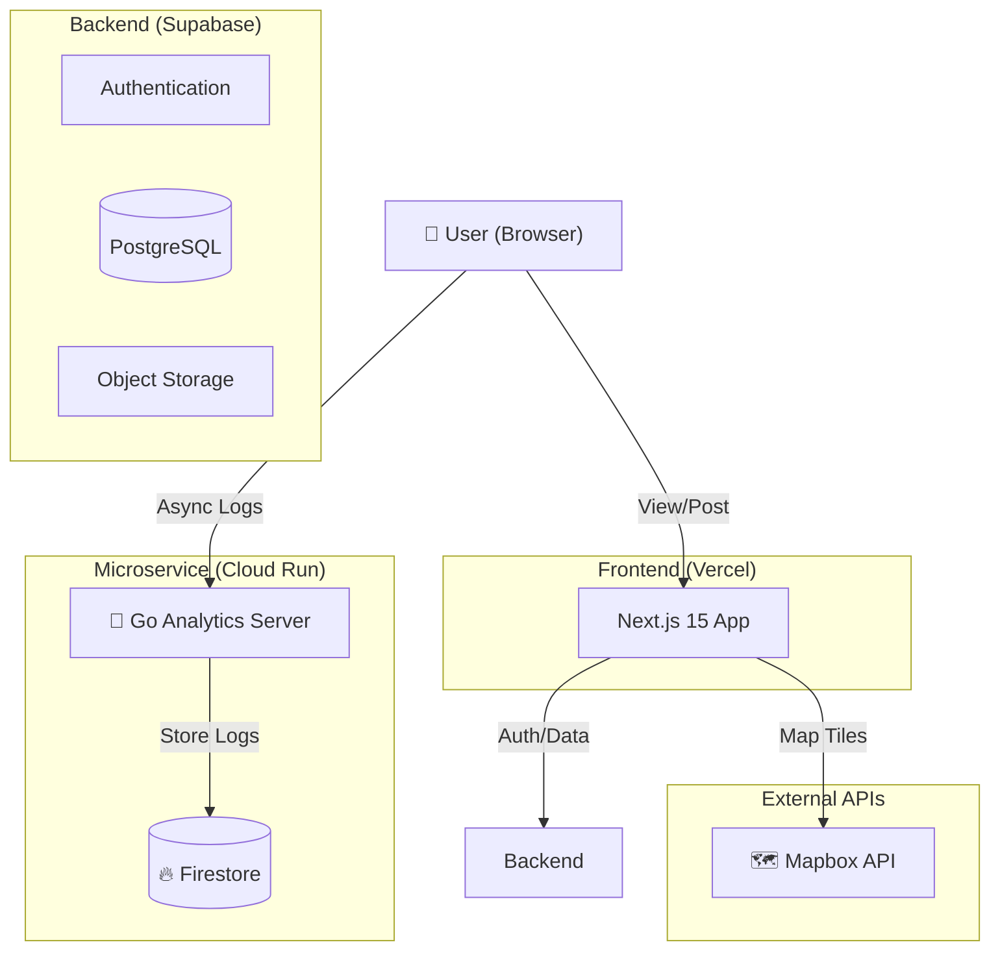

# Mirutabi - Visual Journey Archive 🌍

<p align="center">
  
</p>

<p align="center">
  <b>"Follow the path, find the moment."</b><br>
  Route Sharing & Trust-based Travel SNS built with Next.js 15
</p>

<p align="center">
  
  
  
</p>

---

[🇯🇵 Japanese (日本語)](README.ja.md)

## 📖 Overview

**Mirutabi** is a next-generation travel SNS that shares not just photos, but "Routes (Travel Trajectories)" and "Trust".
It visualizes the "story of getting there" and "actual means of transportation" on a map, which cannot be conveyed by beautiful photos alone. With the **Trust Score Algorithm**, it delivers truly valuable travel information to users, buried in advertisements and influencer marketing.

## ✨ Key Features

### 1. 🗺️ Visual Route Sharing
*   **Overview:** Draws the itinerary on the map with lines and points, saving it in a form that other users can "relive".
*   **Technology:** Adopts `Mapbox GL JS` to achieve fast and beautiful vector map rendering.

### 2. ⭐ Trust Score System
*   **Overview:** Calculates the "reliability of information" based not only on the number of "likes" but also on the concreteness of information and the user's past behavior history.
*   **Technology:** Unique weighting algorithm prioritizes high-quality information in the feed.

### 3. 📸 Experience Archive
*   **Overview:** Records photos, locations, and emotions at that time as a set.
*   **Technology:** Image management via `Supabase Storage` and automatic extraction of location metadata.

### 4. 📊 Golang Analytics Service (Log Analysis)
*   **Overview:** Dedicated microservice for high-speed processing and analysis of user action logs.
*   **Technology:** `Go (Gin)` + `Firebase Firestore` on `Cloud Run`. Decoupled from the main Next.js app to minimize performance impact.

---

## 🛠 Tech Stack

| Category | Technology | Usage |
| :--- | :--- | :--- |
| **Frontend** | **Next.js 15** (App Router) | Fast page rendering with SSR/RSC |
| **Language** | **TypeScript** | Type safety and development efficiency |
| **Styling** | **Tailwind CSS** | Modern UI design using Shadcn UI |
| **Backend** | **Supabase** | Auth, Database (PostgreSQL), Storage |
| **Microservice** | **Go (Gin)** | High-load log collection & analysis service |
| **Database (Log)** | **Firestore** | NoSQL database for analysis |
| **Maps** | **Mapbox / Google Maps** | Map rendering & Place Search API |
| **Deployment** | **Vercel / Cloud Run** | Frontend / Microservice |

---

## 🏗️ Architecture



### 🐹 Go Microservice Strategy
Access analysis and action log collection have a very high write frequency, which can strain the main DB (PostgreSQL) resources.
Therefore, we built a lightweight and fast dedicated server using **Go** and adopted an architecture to offload log data to **Firestore** (Simplified **CQRS** pattern).
This maintains the performance of the main SNS functions (viewing/posting) even as the number of users increases.

---

## 🚀 Getting Started

### Prerequisites
* Node.js 18+
* Supabase Project

### Installation

1. Clone the repository:
   ```bash
   git clone https://github.com/naki0227/mirutabi.git
   cd mirutabi
   ```

2. Install dependencies:
   ```bash
   npm install
   ```

3. Set up environment variables:
   Create `.env.local`:
   ```bash
   NEXT_PUBLIC_SUPABASE_URL=your_url
   NEXT_PUBLIC_SUPABASE_ANON_KEY=your_key
   NEXT_PUBLIC_MAPBOX_TOKEN=your_token
   ```

4. Run:
   ```bash
   npm run dev
   ```

---

## 👨‍💻 Developer
**Enludus** (Information Science Student)

Focus: Web & Mobile App Development
Contact: https://enludus.com

<p align="center"> 
    © 2025 Enludus. All rights reserved. 
</p>
